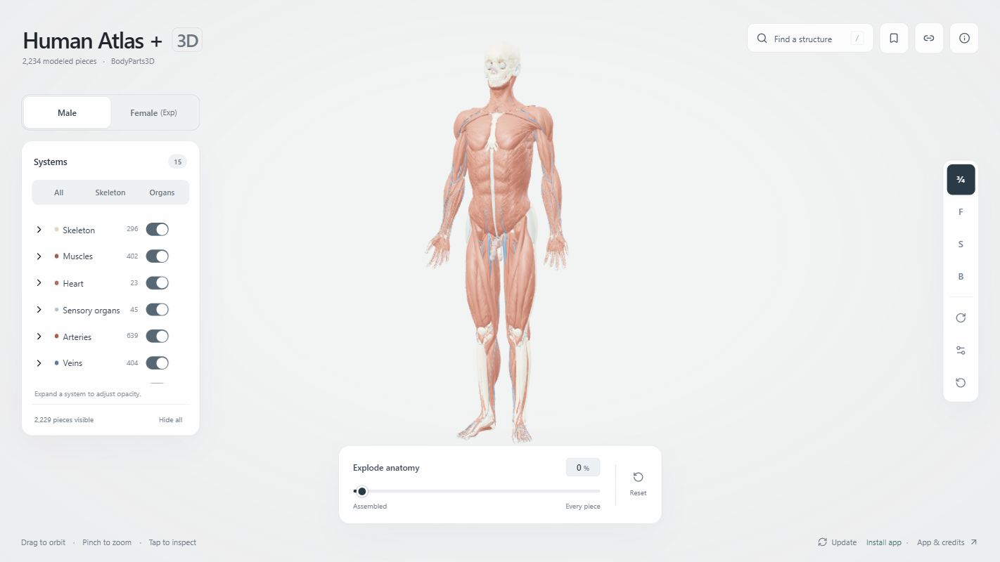
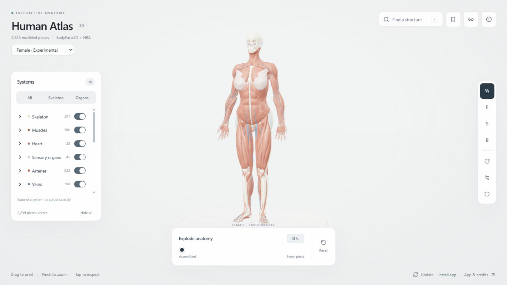

<div align="center">


# Human Atlas +

<p>
  <a href="https://github.com/llm-junkie/ha/actions/workflows/deploy-pages.yml"></a>
  <a href="LICENSE"></a>
  <a href="public/ATTRIBUTION.md"></a>
  <a href="#install-and-use-offline"></a>
</p>

Interactive 3D anatomy for phones, tablets and desktops. Explore the male reference and experimental female model, search structures, adjust layers, and save or share your own views.

**Free · Works offline · No account required**

<a href="https://llm-junkie.github.io/ha/">
  
</a>

<br>

Installation: [iPhone / iPad](#install-on-iphone-or-ipad) · [Mac](#install-on-mac) · [Android](#install-on-android) · [Windows](#install-on-windows) · [Linux](#install-on-linux)

</div>

---

Built with React, Three.js, and shadcn/ui. The **male reference** includes 2,444 selectable meshes, 15 systems, and 3,645 concepts; the **experimental female study model** includes 2,456 meshes, 16 systems, and 4,462 concepts. Both include spinal and peripheral neural structures from Z-Anatomy.

## Preview

| Male · BodyParts3D | Female · Experimental |
| --- | --- |
| [](docs/images/male-atlas.jpg) | [](docs/images/female-atlas.jpg) |

Captured from app **0.3.5** at the same desktop size and default three-quarter view, with anatomy assembled and no structure selected. Click either image for the full-size screenshot. The anatomy shown uses adapted BodyParts3D and HRA data under CC BY 4.0; see [Credits](#credits). The female model's scope and registration checks are documented in [female-model.md](docs/female-model.md).

The female model now includes fitted body skin. [See the final forearm preview](docs/images/female-skin-forearms-fit.jpg) and [skin fit notes](docs/female-skin.md) for the head, neck, back, breast, hand and foot adjustments, source credits, and validation.

## Explore

- Choose **Male (♂)** or **Female (♀)** using the compact icons beside the camera controls. The female model is experimental. The choice is remembered on this device; `?model=female` opens the female model directly.
- The information panel has a separate Male/Female switch for browsing model descriptions and credits. It starts with the current anatomy model each time you open the panel; changing it leaves the anatomy view unchanged.
- Orbit, zoom around the model's center, and select structures directly on the body.
- Toggle systems or individual structures, or use skeleton and organ presets. **Systems (count)** shows the number of enabled system toggles and updates immediately; **Body surface** is first in the list.
- Move from assembled anatomy to a spaced inventory of every visible piece. Ticks mark **45%** and **79%**, where the slider snaps when dragging or tapping nearby; arrow keys retain precise 1% adjustments. Use **Reset** in the bottom dock to restore the view and layers.
- Search anatomical names, source identifiers, and muscle groups such as quads, hamstrings, calves, and glutes. On phones, the search card adjusts above the on-screen keyboard and keeps results scrollable inside it.
- Reopen recent selections, smoothly locate or isolate structures, and return to the overall view.
- Adjust automatic rotation speed and choose its direction. The slider uses a 0–100% scale, with a minimum selectable speed of 10%. The default is 50%, marked at the midpoint with a snap when dragging or tapping nearby; arrow keys keep precise 1% adjustments. Auto-rotate remains available below 80% explosion, matching manual orbit; at 80% and above, the inventory uses panning.
- Adjust background brightness with the sun button; the midpoint snaps to the default gray, with a ±100% range. The title and subtitle automatically use dark or light text for contrast.
- Fade any anatomical system while keeping selected structures clear.
- Save named views on your device and share links that restore the camera, selection, and layers.
- Use compact controls and detail panels on mobile.
- Install the atlas on your home screen or desktop and explore the complete model offline.

The **Systems** button is available in the bottom dock at every screen size, and the panel has an **X** to close it. On desktop, Systems starts pinned open; closing or reopening it remembers that preference on this device. On phones it starts closed, and in portrait it fills the space between the camera controls and bottom dock. Opening or closing Systems overlays the anatomy without changing the camera or rearranging the pieces. The desktop exploded inventory uses balanced left and right space regardless of whether Systems is open.

Body surface is enabled by default at 20% opacity in both models. Expand a system in the layers panel to adjust its opacity from 5% to 100%. **Reset opacity** restores the default appearance; the system switches still control visibility. Faded surfaces yield to solid structures behind them when selecting, and selected structures stay opaque.

The same percentage can look different between models: male skin includes inner and outer surfaces that blend together, while the fitted female skin uses one outer surface. Both use the same color and material settings. Around 35–36% female opacity can look closer to 20% male opacity; the visual match depends on the camera and visible anatomy.

Selection preserves each structure's original hue, doubles its saturation (up to 100%), and reduces its lightness by 25%, so white and gray structures also stand out. **Locate** reveals selected structures through surrounding anatomy on the first click while preserving their lighting, surface detail, and depth between selected pieces. **Isolate** shows the original colors; **Surroundings** restores the selection highlight. Closing the detail panel clears the selection and its highlight.

The explode percentage stays where you set it while searching, locating, isolating, showing surroundings, or returning to the overall view. **Locate** frames the selected structure at its current exploded position. Inspection keeps the surrounding pieces in their existing slots, including when temporarily revealing a hidden structure, and preserves your layer choices. **Return to overall view** fits the current arrangement; **Reset** reassembles it at 0%.

Use the bookmark button to save up to 20 named views in this browser, reopen them, or delete them. The link button creates a shareable view, with a copyable field if clipboard access is unavailable. Saving or sharing pauses automatic rotation. Views include the current orbit, zoom, pan, inspector framing, visible systems, individual structure switches, opacity, and exploded layout. Shared views adapt their camera distance on narrower screens and work under the GitHub Pages repository path. Bookmarks remain on this device; links carry the view itself and need no account or server.

## Install and use offline

Open the published site and choose the **information button** or **Install app** below the dock, then **Install Human Atlas +** in **Take the atlas with you**, at the top of the panel. **Install app**, **Update available**, or the installed version appears centered below the dock on phones and desktops. The desktop footer keeps offline status and **App & credits** on the right; phones hide those extra footer items. The install button opens a native install prompt when supported; otherwise it shows installation steps. The install button remains available after offline saving finishes. **Ready offline** confirms that files are saved, independently of installation; the atlas also works offline in a regular browser tab.

Stay connected until the anatomy finishes loading and the panel confirms **Ready offline**. The app saves its interface, both catalogues, credits, and all 38 model chunks automatically (about 78.5 MB compressed combined). The selected model's normal download is reused, and the other model is saved in the background. Both can then be explored offline. It also supports browsers that need the uncompressed files. The first visit can finish before the service worker takes control; offline preparation fills missing cache entries afterward.

Once ready, you can reopen the atlas, search, change layers, save views, and open previously copied view links without a connection. Bookmarks and offline files belong to this browser on this device. Clearing site data removes them, and browsers can evict offline files when storage is low. The panel reports incomplete saving and offers a retry; external source websites still need a connection.

Open **Information** and use its **Update** button to check for a new release and apply it. The centered version or **Update available** below the dock opens the updates section directly. The panel confirms when you are up to date, reports connection or saving failures, and waits for a new offline copy to finish preparing before reloading open atlas windows. Saved bookmarks remain. **Update available** also appears when a background check finds a prepared release; it can be applied offline. A release also activates when all old atlas windows are closed. UI-only updates reuse the existing geometry cache. Content hashes keep each catalogue and its geometry together, and old caches are removed only after the new app activates.

PWA registration runs in production builds on HTTPS or localhost. Development stays uncached so edits appear immediately. The manifest, icons, worker scope, and offline navigation use the configured base path, including `/ha/` on GitHub Pages. No extra dependencies or deployment secrets are needed.

### Install on iPhone or iPad

Open [Human Atlas +](https://llm-junkie.github.io/ha/) in **Safari**, choose **Share → Add to Home Screen**, leave **Open as Web App** enabled if shown, then tap **Add**. You may need to open the page menu to find Share, or tap More / View More to find Add to Home Screen. Safari does not provide a website-triggered install prompt.

### Install on Mac

On **macOS 14 or later**, open [Human Atlas +](https://llm-junkie.github.io/ha/) in **Safari**, choose **File → Add to Dock**, then click **Add**. See [Apple's web app guide](https://support.apple.com/en-us/104996).

### Install on Android

Open [Human Atlas +](https://llm-junkie.github.io/ha/) in **Chrome** and use the atlas's **Install Human Atlas +** button. You can also choose **⋮ → Install and create shortcut → Install**. Confirm the prompt, then open the atlas from your Home Screen or app drawer. See [Chrome's Android installation guide](https://support.google.com/chrome/answer/9658361?hl=en&co=GENIE.Platform%3DAndroid).

### Install on Windows

Open [Human Atlas +](https://llm-junkie.github.io/ha/) in **Edge** or **Chrome**, click **Install Human Atlas +** in the atlas or the install icon in the browser's address bar, and confirm. Open it from the Start menu or its app shortcut.

### Install on Linux

Open [Human Atlas +](https://llm-junkie.github.io/ha/) in **Chrome** and click **Install Human Atlas +** in the atlas, or choose **⋮ → Cast, save, and share → Install page as app**. Confirm, then open it from your applications menu. See [Chrome's desktop installation guide](https://support.google.com/chrome/answer/9658361?hl=en&co=GENIE.Platform%3DDesktop).

After installing on any device, open the installed atlas while connected and wait for **Ready offline** before disconnecting.

## App version

The current app release is **0.5.1**. The **Information** panel shows **Current version 0.5.1**, including when the app is installed or offline. The display and built files read the version from `package.json`.

Release **0.3.5** adds a selectable full-body female skin surface, smoother contours, closer head/face/neck/back alignment, breast coverage, posed hand and foot skin, and medial forearm coverage. The delivered female catalogue has 2,456 meshes and 4,462 concepts. Source pins, fitting controls, comparison previews and geometry checks are documented in [the skin fit notes](docs/female-skin.md).

For the next release, run `npm version patch --no-git-tag-version` for fixes, or `npm version minor --no-git-tag-version` for new features. This updates `package.json` and `package-lock.json` together. Validate and deploy the release as usual; installed apps show the new version after an update. Each build still has a content-based cache identifier, so builds with the same release number can update correctly.

## Run locally

Use Node.js 24 LTS (specified in `.nvmrc`); Node.js 22.18 or newer is supported. No API keys or accounts are needed.

```sh
npm ci
npm run dev
```

Open http://localhost:3016. To build the static site, run `npm run build`; the output is in `dist/`.

## Validate

```sh
npm run check
npm run lint
npm test
npm run build
```

Validation covers mesh buffers, names and concept membership, nonoverlapping exploded layouts at desktop and mobile aspect ratios, search and inspection contracts, tap-versus-drag handling, asset URLs under GitHub Pages subpaths, and compressed model downloads. Browser interaction checks have exercised selection, system controls, search, isolation, rotation, and 390×844, 320×568, and 844×390 layouts. Phone controls stay clear of the exploded inventory, and isolated structures fit the space above or beside the detail panel. Physical-device performance and real multitouch hardware have not been tested.

Focused viewer tests also cover muscle-group membership, individual visibility, recent history, hidden-geometry drawing, frame scheduling, centered wheel zoom with inspector offsets and distance limits, saved-view and link validation, storage failures, camera restoration, and layer opacity. Selection-color tests check saturation limits, white and gray colors, preserved hue, and repeated selection without modifying the original material color.

WebKit and Chromium browser checks cover Systems counts and presets in both models, closing and reopening the panel without changing camera matrices, close-button spacing, slider layouts, phone panel height, and consistent desktop row heights across the 1400px breakpoint. These checks use desktop browser engines, not physical iOS or iPadOS devices.

Female skin tests verify the source and delivered checksums, preserved underlying anatomy, finite geometry and normals, smoothing and deformation bounds, joined wrist/ankle topology, and skin coverage over breast adipose tissue, hand/toe bones and medial forearm tissue. Geometric checks do not replace independent anatomical review.

Runtime regression tests also cover malformed catalogues, bounded concurrent downloads, cancellation after a failed chunk or model switch, partial GPU index uploads, and offline progress checks without opening cached model bodies. `npm test` discovers all `scripts/*.test.mjs` files automatically; CI also runs lint to reject unused imports and other source warnings.

PWA tests cover offline navigation and anatomy, subpath isolation, download deduplication, gzip and raw responses, damaged downloads, storage limits, update activation, cache reuse, and failed updates. Manual-update tests cover checking for releases, using an already prepared release without a connection, waiting for downloads, and recovering from connection or installation failures. Every production build also validates the manifest, PNG icon sizes, scoped URLs, and content hashes against the files being deployed.

The production `/ha/` preview has also been reopened with its server stopped: full anatomy, search, and isolation remained usable. Browser checks confirmed that **Update** applies a new release, reports when the app is current, and allows retrying a failed connection. Update controls and feedback remain visible on a small phone layout. Saved views were retained after an update. The manual install button, expandable iPhone/iPad steps, persistent install link, and offline status were checked on a small phone layout; OS-level installation on physical phones has not been tested.

## Anatomy data

The male viewer uses **BodyParts3D 4.0**, an adult male reference anatomy, licensed **CC BY 4.0**. The female mode imports Anatolume's pinned experimental model, combining adapted BodyParts3D anatomy with HRA female structures. It also includes [fitted HRA female body skin](docs/female-skin.md), using the same Body surface controls as the male model. Neither represents every structure or variation. Female proportions and organ placement await independent anatomical review; detailed external genital anatomy and validated urethra/pelvic-floor replacements remain incomplete.

The female uterosacral registration corrects a mismatch between the reproductive and pelvic transforms while preserving the genital attachment region. Source comparison, anatomical references, measurements, mesh checks, and before/after projections are documented in [female-model.md](docs/female-model.md). This verifies registration consistency, rather than independently validating the source attachment anatomy.

Individual source meshes are distinct from named concepts, which may group multiple meshes. Histories and up to 20 bookmarks per model are kept separately; shared links include the model, and existing male links remain compatible.

Geometry is simplified for browser performance. The male reference retains all 2,234 BodyParts3D meshes; the derived female model combines 2,181 adapted BodyParts3D meshes with 64 HRA meshes. Each adds 210 Z-Anatomy meshes for spinal cord tissue, roots/ganglia, trunk and limb nerves. Branches remain independently selectable. Their registration is estimated; [the neural model notes](docs/z-anatomy-nerves.md) record source identities, reliable classification references and measured placement limits.

| Model | Meshes | Concepts | Systems | Triangles | Compressed geometry |
| --- | ---: | ---: | ---: | ---: | ---: |
| Male · BodyParts3D + Z-Anatomy | 2,444 | 3,645 | 15 | 2,634,798 | About 37.4 MB |
| Female · Experimental | 2,456 | 4,462 | 16 | 2,889,994 | About 41.0 MB |

Both models total about 78.5 MB compressed. Full source links, licenses, and adaptation details are in [ATTRIBUTION.md](public/ATTRIBUTION.md).

Both catalogues include 140 source-verified classification overrides, including the iliotibial tracts and corrections for muscles, cartilage/discs, teeth, cerebral fluid spaces, liver segments, and papillary heart muscles. The [classification audit](docs/anatomy-classification.md) documents the layer policy, references, and reproducible corrections.

This is an educational explorer, not a diagnostic or surgical tool.

## How it works

Geometry is merged into batches whose draw indices contain only visible structures. Visibility changes upload only the used index range. Per-structure GPU textures control translation and selection, while component geometry supports accurate picking. Exploded layouts pack only visible pieces; layout, visibility and selection buffers stay cached during animation. The frame loop wakes for interactions, loading and animations, then stops when the view is still. It also pauses while the browser tab is hidden.

Model downloads run three chunks at a time and cancel together on failure or a model switch. Catalogue validation checks structure, identifiers, bounds and buffer ranges before rendering. Switching models releases the previous WebGL context and its resources. Offline progress reads cache keys without reopening every model response. Styles are generated only from application, UI component and web entry sources; temporary files and documentation cannot expand the stylesheet.

Recent selections are stored locally in the browser. Muscle search shortcuts group verified source meshes without modifying the source catalogue. Guided camera movement respects the reduced-motion setting and yields to manual navigation.

The optional WebMCP tools expose anatomy search and inspection in compatible browsers. The visible interface works without them.

## Rebuilding geometry

The repository includes browser-ready geometry. Rebuilding it is optional: obtain the official BodyParts3D OBJ archive and English metadata tables, prepare the joined concepts and display-system mappings, run `scripts/convert-anatomy.py`, then `node scripts/optimize-anatomy.mjs` and `node scripts/compress-models.mjs`. Simplification uses a 0.2% relative error limit per structure.

The female model has a separate pinned import and registration pipeline. Follow [the female rebuild instructions](docs/female-model.md#repeat-the-checks) to reproduce its assets, measurement report, and comparison figure.

After the base imports and classification corrections, [reapply the Z-Anatomy supplement](docs/z-anatomy-nerves.md#reproduce), then [reapply the female skin](docs/female-skin.md#rebuild-and-verify). Both supplements preserve the existing meshes and refresh the female catalogue checksum. The new chunks are included automatically in offline model caching.

## Deploy

The included [GitHub Actions workflow](.github/workflows/deploy-pages.yml) builds and deploys the static site directly to GitHub Pages.

1. In the fork's **Settings → Pages**, set **Source** to **GitHub Actions**.
2. Push these changes to `main`, or run **Deploy to GitHub Pages** from the **Actions** tab.
3. Open the site URL shown by the deployment. For this fork, it is https://llm-junkie.github.io/ha/.

Every push to `main` installs dependencies with `npm ci`, checks types, runs lint and validation, builds `dist/`, and deploys it. Pull requests run the same checks and build without publishing. No Vercel account, deployment token, or additional secrets are needed.

The build reads the site's base path from GitHub Pages, so model downloads, scripts, styles, and the favicon work under a repository path such as `/ha/`, a renamed fork, or a custom domain. To test the repository path locally:

```sh
npm run build -- --base=/ha/
npm run preview -- --base=/ha/
```

In Windows PowerShell, use `npm.cmd` in these two commands so the `--base` option is passed through to Vite.

Open http://localhost:4173/ha/. A normal `npm run build` uses `/` and can also be served by another static host. `BASE_PATH` can override that default for other subpath deployments. The 3D viewer requires WebGL 2.

## Credits

| Contributor / source | Contribution used in this fork |
| --- | --- |
| **Ashe Magalhaes / [ashemag/human-atlas](https://github.com/ashemag/human-atlas)** | Original Human Atlas application, interface, anatomy explorer, and BodyParts3D conversion foundation. |
| **isunky / Anatolume** ([viewer revision](https://github.com/isunky/Anatolume/tree/3cef53da908c902f13bd48c10cd6365de162c150), [female import revision](https://github.com/isunky/Anatolume/tree/39f2c018205faa756ab59b4b12fdf0d1295cfdaf)) | Rendering performance, navigation improvements, and the packaged female model import. |
| **[wiiiimm/human-atlas](https://github.com/wiiiimm/human-atlas/tree/9c1dd3d222a54844c1a8b54870663ce63b9d53b0)** | Cursor-centred zoom, muscle-group search, and the fork foundation used by Human Atlas Enhanced. |
| **PrejudiceNeutrino / [Human Atlas Enhanced](https://github.com/PrejudiceNeutrino/human-atlas-enhanced/tree/9e0d710fcc1d467dc758d61d6f417231cb1472fe)** | Experimental female assembly, HRA integration, estimated body/breast adaptations, and upstream fit records. |
| **[BodyParts3D / Database Center for Life Science](https://dbarchive.biosciencedbc.jp/en/bodyparts3d/download.html)** | BodyParts3D 4.0 male reference geometry, anatomical names, and concept relationships. |
| **Kristen Browne and Heidi Schlehlein / [Human Reference Atlas · HuBMAP](https://doi.org/10.48539/HBM352.BTSQ.586)** | *3D Reference Organ Set for United, Female, v1.5* (2023): the female HRA source geometry. |
| **Kristen Browne and contributors / [HuBMAP CCF 3D Reference Object Library](https://github.com/hubmapconsortium/ccf-releases/blob/b036a91aaf7234f462b1249d4a5f4fb0e982f412/v1.3/models/3d-vh-f-skin.glb)** | Female body skin from v1.3, fitted locally with posed BodyParts3D hand/foot patches under CC BY 4.0. |
| **Gauthier Kervyn and contributors / [Z-Anatomy](https://github.com/Z-Anatomy/Models-of-human-anatomy), distributed by [Lluís Vinent Juanico](https://github.com/LluisV/Z-Anatomy)** | Spinal and peripheral neural source surfaces, adapted for both models under CC BY-SA 4.0. |
| **[Rayzi0417 / PR #283](https://github.com/ashemag/human-atlas/pull/283)** | Reference for the peripheral-nerve integration. |

Human Atlas Enhanced also credits [Female Atlas by Mahendra Beniwal](https://github.com/HiMahendraBeniwal/female-atlas/tree/b0a20fa3a009ca5f6bfa07b7479312e04c862af2) as an inspiration for its breast presentation; the packaged female geometry comes from the HRA dataset above.

BodyParts3D, © The Database Center for Life Science licensed under CC Attribution 4.0 International. HRA female source data by Kristen Browne and Heidi Schlehlein (2023), published by HuBMAP, licensed under CC BY 4.0. These data credits also apply to the anatomy rendered in the screenshots and comparison figure.

This fork adds GitHub Pages deployment, dependency updates, saved views, layer opacity, PWA installation and updates, model-specific state, and the verified bilateral uterosacral registration correction. Source revisions, geometry changes, and validation limits are recorded in [the full attribution](public/ATTRIBUTION.md) and [female model notes](docs/female-model.md).

## License

Application code is released under the [MIT License](LICENSE), retaining the original copyright notice for ashemag. Original BodyParts3D and HRA mesh assets use [CC BY 4.0](https://creativecommons.org/licenses/by/4.0/). **Z-Anatomy adaptations and the combined atlas catalogues use [CC BY-SA 4.0](https://creativecommons.org/licenses/by-sa/4.0/)**. Preserve source credits, identify modifications and follow applicable share-alike terms for derived data and rendered images. Full notices and adaptation records are in [ATTRIBUTION.md](public/ATTRIBUTION.md). Third-party dependencies retain their respective licenses.

Issues and pull requests are welcome. Please include reproduction steps and browser/device details for interaction problems.
