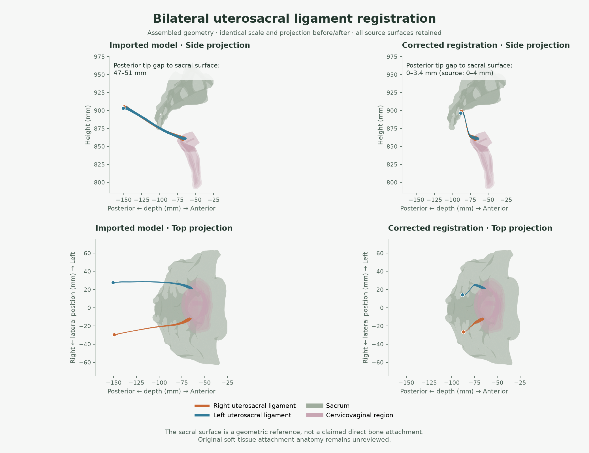

# Female model and uterosacral registration

The model switch adds **Female (Exp)** beside the male reference; **Exp** means experimental. Female search, layer opacity, isolation, muscle groups, saved views, and share links use the female catalogue. Histories and bookmarks are stored separately; old male bookmarks and links remain compatible. Shared links include the model identity. Switching aborts the previous download and disposes its scene. Both models are included in the PWA's verified offline cache and work under `/ha/` without extra routes or deployment dependencies.

## Sources and scope

Base assets are pinned to [Anatolume 39f2c01](https://github.com/isunky/Anatolume/tree/39f2c018205faa756ab59b4b12fdf0d1295cfdaf), importing [Human Atlas Enhanced 9e0d710](https://github.com/PrejudiceNeutrino/human-atlas-enhanced/tree/9e0d710fcc1d467dc758d61d6f417231cb1472fe). That assembly contains 2,181 adapted BodyParts3D meshes and 64 HRA meshes: pelvis (8), reproductive structures (38), breasts (16), and knee ligaments (2), totaling 2,245 selectable meshes and 4,248 concepts. The [Z-Anatomy supplement](z-anatomy-nerves.md) adds 210 neural meshes and 213 concepts; the assembly at that stage has 2,455 meshes and 4,461 concepts. Breast tissue is separate from the nipple/areolar surface layer.

The application originates with **Ashe Magalhaes / [ashemag/human-atlas](https://github.com/ashemag/human-atlas)**, under MIT. Anatolume supplies the imported package; PrejudiceNeutrino's Human Atlas Enhanced supplies the female assembly and adaptation records, building on wiiiimm's fork. BodyParts3D is credited to the Database Center for Life Science. The female HRA geometry is by **Kristen Browne and Heidi Schlehlein**, *3D Reference Organ Set for United, Female, v1.5* (2023), published by HuBMAP, [DOI 10.48539/HBM352.BTSQ.586](https://doi.org/10.48539/HBM352.BTSQ.586). Both anatomy datasets use CC BY 4.0. The upstream female assembly also credits [Female Atlas by Mahendra Beniwal](https://github.com/HiMahendraBeniwal/female-atlas/tree/b0a20fa3a009ca5f6bfa07b7479312e04c862af2) as breast-presentation inspiration.

This is an experimental derived model. The musculature comes from the male reference; proportions and organ placement are estimates. A later [HRA female skin supplement](female-skin.md) adds the complete external body surface, bringing the catalogue to 2,456 meshes and 4,462 concepts. Detailed external genital anatomy and validated urethra/pelvic-floor replacements remain incomplete. Independent anatomical review is still pending. The upstream fit report is retained unchanged; the local registrations have separate reports. Dataset attribution and adaptation notes are in [ATTRIBUTION.md](../public/ATTRIBUTION.md).

The skin supplement includes smoother contours, localized head/face/ear/neck/back alignment, coverage around both breasts and medial forearms, and external hand/foot patches in the existing female pose. It uses the Body surface controls and is searchable as **Female body skin**. The [skin fit notes](female-skin.md) document the final previews, source and patch hashes, fitting recipe, opacity behavior, rebuild sequence, and geometric validation limits.

## Reproducing the reported defect

The original HRA reproductive assembly and pelvic bones occupy one source frame. The derived model fits the reproductive group against male bladder bounds, but fits the pelvis against male hip bounds. These two affine transforms differ, particularly in depth. Applying the reproductive transform to both ends of a uterosacral ligament preserves its genital relationship but displaces its posterior relationship with the separately transformed pelvis.

The pinned source vertices reproduce the imported ligament positions to within 0.00003 mm. Thus the visible protrusions are present in the asset registration; they are not caused by camera controls, layer offsets, or exploded layout. Measurement uses the assembled model and closest points on **sacral triangles**, rather than bounding-box distances.

| Posterior cap | Original HRA gap | Imported model gap | Corrected gap |
| --- | ---: | ---: | ---: |
| Right ligament | 0.001–3.364 mm | 47.130–50.698 mm | 0.001–2.714 mm |
| Left ligament | 0.634–3.971 mm | 47.384–51.319 mm | 0.529–3.333 mm |

These are surface distances for 15 pinned posterior vertices per side. The sacrum is a registration reference, **not an assertion of direct attachment to bone**. Original source near-contact/intersection is retained; these numbers do not validate a soft-tissue insertion site.

## Anatomical requirements and limits

The user's suggested references were checked against the publications:

- [Ramanah et al. (2012), Figure 6](https://pmc.ncbi.nlm.nih.gov/articles/PMC3515066/#F6): genital attachment regions include the cervix/upper vagina; posterior regions include coccygeus/sacrospinous and presacral tissues. Their sample did not identify direct sacral attachment.
- [Chen et al. (2013), Figures 1 and 3](https://pmc.ncbi.nlm.nih.gov/articles/PMC3986864/): MRI landmarks and reconstructed attachment-to-attachment paths establish the reference method. Its measured deep component cannot be assumed to represent the entire exported HRA mesh.
- [Umek et al. (2004)](https://pmc.ncbi.nlm.nih.gov/articles/PMC1226709/): posterior attachments vary. A universal sacral snap point would misrepresent that variation.

These studies constrain the interpretation; they supply no coordinates for this derived atlas. The correction restores source registration consistency. The source has no separately reviewed superficial/deep component labels or validated coccygeus/presacral attachment surfaces. Its intermediate path and teaching accuracy require anatomical review.

## Accepted correction

The anterior 10% of the source depth span remains in the imported reproductive frame. This includes all source vertices within 5 mm of the HRA cervicovaginal surface: a preservation envelope, not a clinical tolerance. All 77 right and 66 left original vertices in this cap retain their exact imported positions and normals. The posterior 5% follows the **recorded pelvic transform**, retaining the original source relationship to the pelvis.

The intervening field joins those registrations with a C1, strictly monotone depth map, then applies the unchanged body morph. No arbitrary XYZ offsets, clipping, hidden ligaments, or external bone snap points are used. The intermediate path is an estimated registration, rather than a patient-specific reconstruction. Posterior depth cannot reverse or overshoot between the caps.

The coarse, long source triangles are tessellated in 0.25 mm depth bands before deformation. New points within 0.1 micrometre are welded to avoid slivers below the Float32 precision; every original source vertex remains. The measured source surface area is preserved within 1e-8 relative error. Both corrected meshes are written to one additional chunk. All other geometry chunks and mesh geometry remain unchanged.

The ligament-corrected base model has 18 female chunks and 2,469,472 triangles. The neural supplement adds two chunks and 346,530 triangles; current compressed female geometry is about 40.1 MB. Raw equivalents support browsers without gzip decompression. Base source and delivered catalogue checksums are recorded separately in `public/models/female-source.json`; the supplement has its own `z-anatomy-source.json` provenance.



The retained genital region, posterior endpoint relationship, posterior course, and triangle quality are checked independently. Minimum sampled Jacobian determinants are 0.126 (right) and 0.145 (left); all tested triangles retain positive area and consistent orientation. Uniform translation and a smooth height-based blend were rejected: the former moved the genital end, and the latter introduced path overshoot and inverted coarse triangles.

## Repeat the checks

Validation for this integration: all 53 tests and TypeScript checks passed, as did production builds at `/` and `/ha/`. Browser checks covered desktop, 390×844 and 320×568 portrait layouts, and 568×320 landscape. The female Organs preset includes breast tissue. Female bookmarks survived switching to male and back; a female share link restored the correct model and both ligaments.

The PWA update completed and reported Ready offline. After stopping the preview server and confirming no listener remained, the browser reloaded the female model, switched to the male model, and opened the female shared ligament view entirely from the cache. Both geometries rendered; no browser errors were recorded. The complete pinned import/correction pipeline was also rerun in an isolated output directory and reproduced every delivered asset and report checksum.

```sh
npm run check
npm test
npm run build
npm run build -- --base=/ha/
node scripts/female-ligaments.test.mjs --report
python scripts/render-female-registration.py
```

The final two commands write a measurement report under ignored `work/` and regenerate the comparison figure. Rendering requires numpy/matplotlib; the app and CI need only the existing Node dependencies. `data/anatomy/uterosacral-source.json` preserves source ligament vertices, normals, indices, pre-fix positions, attachment-region surfaces, and source chunk hashes, under the same dataset attribution.

To rebuild from the pinned import using a local Anatolume checkout:

```sh
node scripts/import-female-model.mjs /path/to/Anatolume
node scripts/fix-female-ligaments.mjs
node scripts/apply-classification-overrides.mjs
node scripts/import-z-anatomy-nerves.mjs --source-dir D:\DEV\ha\tmp\z-anatomy --download
node scripts/import-female-skin.mjs --download
npm test
```

The override pass applies all 140 verified classification records and refreshes the delivered catalogue checksum. See the [classification audit](anatomy-classification.md) for source references, layer policy, and the 138 additional corrections shared with the male catalogue.

The correction script rejects already modified imports. Source pins or geometry changes require renewed endpoint, path, surface, and visual checks. Automated passing results establish mesh integrity and source registration consistency; they do not replace independent anatomical review.

## Model screenshots

The [README preview](../README.md#preview) places the male and female screenshots in one row. Both were refreshed from the Human Atlas + production `/ha/` preview on **2026-10-12**, app **0.2.0**, at **1422×800**. They use the default three-quarter camera, default visible layers and opacity, assembled geometry (0% explode), paused rotation, and no selected structure. These are app screenshots; the controlled before/after figure above provides the registration comparison.

To refresh the screenshots, build with `npm run build -- --base=/ha/` and serve with `npm run preview -- --base=/ha/`. Open `?model=male`, wait for geometry to finish, and capture the viewport. Switch to **Female (Exp)** and capture again at the same viewport size after loading. **Reset view and layers** restores the default presentation if it has changed. Save the images as `docs/images/male-atlas.jpg` and `docs/images/female-atlas.jpg`. Retain the dataset credits in [ATTRIBUTION.md](../public/ATTRIBUTION.md) when reusing the images.
