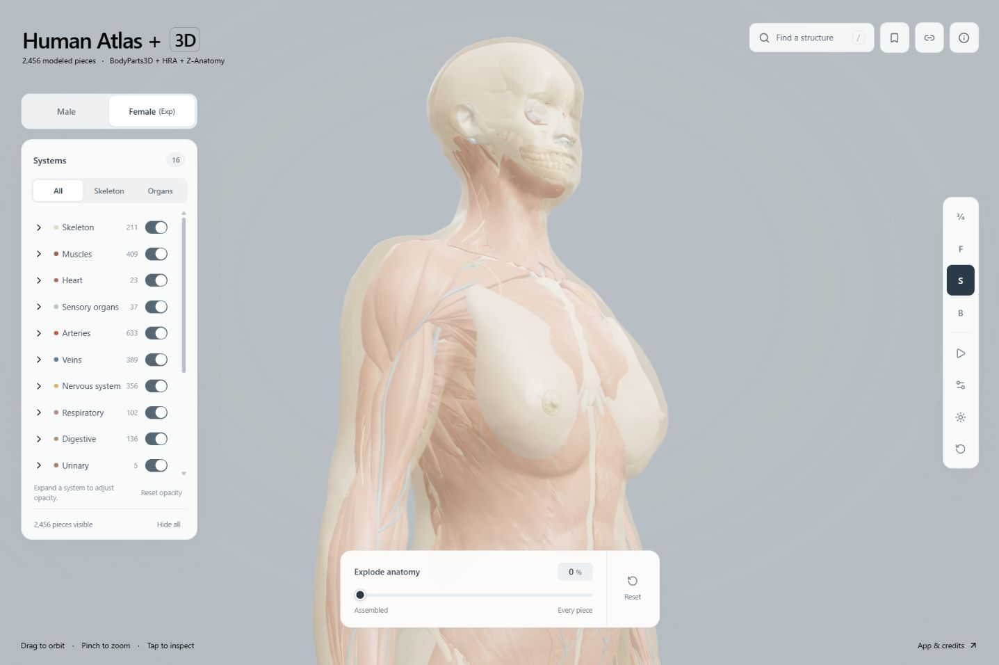

# Fitted female body skin

The female atlas now includes a complete external female skin surface in **Body surface**. It uses the same 20% default opacity as the male skin; the layer and individual structure controls can hide it or make it opaque. Searching **skin** finds **Female body skin**, which can be selected and isolated independently of the existing nipple and areolar meshes.

Both models use the same skin color and material settings, but their transparency accumulates differently. The male reference contains inner and outer skin surfaces; the fitted female skin mostly has one outer surface. Two overlapping surfaces at 20% opacity combine to approximately 36% opacity (`1 - (1 - 0.2)^2`). Female opacity around 35–36% can therefore look closer to male 20%, depending on the viewing angle and anatomy behind the skin. The slider still controls each rendered surface directly; no model-specific opacity compensation is applied.



Previews from the local atlas on 2026-10-12: [forearm coverage](images/female-skin-forearms-fit.jpg), [hand fit](images/female-skin-hands-fit.jpg), [foot fit](images/female-skin-feet-fit.jpg), [face and ear alignment](images/female-skin-face-fit.jpg). Earlier stages: [head profile adjustment](images/female-skin-head-profile-fit.jpg), [scalp/neck adjustment](images/female-skin-head-neck-tightened.jpg), [upper-back adjustment](images/female-skin-back-tightened.jpg), [smoothed preview before the back adjustment](images/female-skin-smoothed.jpg), [initial fit](images/female-skin-fit.jpg). Small intersections with fine internal structures can remain visible at full opacity; the fitted source is credited below.

## Source and license

The source is `VH_F_skin` from the [Human Reference Atlas / HuBMAP CCF 3D Reference Object Library](https://humanatlas.io/3d-reference-library), released under [CC BY 4.0](https://creativecommons.org/licenses/by/4.0/). The exact file is [3d-vh-f-skin.glb in CCF release v1.3](https://github.com/hubmapconsortium/ccf-releases/blob/b036a91aaf7234f462b1249d4a5f4fb0e982f412/v1.3/models/3d-vh-f-skin.glb). Credit: Human Reference Atlas / HuBMAP, Kristen Browne and contributors. The original 12,246,132-byte GLB has SHA-256 `0fc377c7a2e7e9644b81d318feda9d0b2c5a38f39bd14e74966f8b6364eb0a78`.

The file supplies the female trunk, head and limb surface. The retained BodyParts3D skin also supplies posed external hand and foot patches after the existing female body morph, under the same CC BY 4.0 license; its genital geometry is excluded from both the patches and paired surface controls. The delivered skin combines these surfaces into one selectable mesh.

## Registration

The source is simplified from 382,640 to 84,180 triangles using a 0.2 mm absolute meshoptimizer error target. The achieved source error is recorded in `public/models/female-skin-source.json`. The simplified source has 42,092 vertices.

Paired cross-sections match the outer body shape to the existing female morph. The breast envelope also uses the installed HRA breast tissue. Head, hands and feet have separate pose controls; hand fingertips are matched to the corresponding atlas fingers. Sparse additional controls reduce intersections against sampled bones, muscles and breast surfaces. A global thin-plate radial basis field joins the controls continuously, with smoothing `0.0001`. A smooth radial clearance envelope adds room around retained anatomy, with separate limb, knee, ankle and neck transitions. Its parameters, paired coordinates and all base-geometry hashes are retained in `data/anatomy/female-skin.json`.

Torso control regularization blends from the original `0.0001` to `0.0101` to suppress larger chest/waist fitting ripples. The head and limb controls retain their original strength.

The lateral breast skin receives up to 12 mm of outward clearance on both sides, tapered through the surrounding chest surface and before the anterior nipple region. This covers the previously exposed outer adipose patches without changing the breast tissue meshes. A radial ray review against every retained adipose vertex and triangle centroid checked 21,837 left and 123,011 right samples after smoothing, with no sampled protrusions; the minimum directional clearance was 2.40 mm on the left and 3.68 mm on the right. A regression check also compares the delivered lateral skin triangles directly against the adipose vertices in the affected region. The adjustment participates in the composed field and triangle checks.

The upper back and posterior neck receive a localized forward contour adjustment, up to 14 mm on the back and 22 mm at the neck. Smooth transitions taper the adjustment toward the waist, shoulders, anterior surface and scalp. Back movement is reduced along the spine to retain room around its projecting processes. The adjustment is included in the composed field Jacobian check and does not change the underlying anatomy.

The lateral neck contour is narrowed with a maximum 24% width reduction, tapered toward the shoulders, jaw and anterior surface. The crown is lowered by up to 6.5 mm and narrowed by up to 2.5%, fading out above the face. These adjustments are included in the composed field checks. A separate ray review of the delivered surface retained positive clearance for the checked bone and muscle vertices around both sides of the neck/shoulders and above the skull; this remains a geometric review of the derived assembly.

A coordinated depth correction retracts the face, chin and anterior throat by a smoothly interpolated profile, up to 17 mm at the upper throat. The nose is lowered locally by up to 3 mm. A separate upper posterior scalp correction reduces the local bulge by up to 13 mm using a smooth height falloff into the crown and lower scalp. The correction tapers into the cheeks and preserves the tighter neck/shoulder fit. The delivered profile was reviewed against 58,530 anterior, 6,209 posterior scalp and 3,476 crown bone/muscle vertices, with positive ray clearance at all checked points. All adjustments participate in the composed field and triangle checks; the ray review does not establish clinical anatomical accuracy or complete enclosure.

A further facial alignment lowers the eye, nose and mouth region by up to 10 mm, tapering toward the chin and upper forehead. The ear surface moves down by up to 6 mm, forward by 4 mm and outward by 2 mm. The crown above 1.58 m receives no movement from this adjustment. The anterior, posterior scalp and crown ray review retains positive clearance after alignment.

After fitting, 100 distance-weighted Taubin relaxation cycles soften uneven local contours. The face, hands and feet receive lighter smoothing. A smooth displacement cap limits movement to 6 mm, and inward movement is limited to 1.5 mm on the body and less in detail regions to retain clearance around the anatomy. Local backtracking rejects any delivered triangle that would reverse orientation. This retains the mesh count and silhouette without ordinary Laplacian shrinkage; the signed surface-volume measure changes by less than 1%.

The import checks the registration and clearance field's Jacobian at every source vertex and additional triangle centroids, rejecting nonpositive samples before mesh relaxation. After relaxation it checks the orientation of every triangle against the fitted surface, finite coordinates and nondegenerate delivered triangles. Normals are recomputed from the delivered Float32 geometry after joining and the final forearm adjustment; ambiguous coincident source seams retain their orientation through the inverse-transpose registration field. The report records both sets of measurements and delivered checksums.

After HRA relaxation, the mismatched hand and foot poses are replaced by the outer reference surfaces in the unchanged female atlas frame. The patches have bounded outward clearance, with local triangle backtracking while preparing the pinned fixture. Shared wrist and ankle boundary loops join the patches to the retained HRA skin; no new open edges are introduced. Two original HRA nonmanifold seams remain at an ear and knee. The joined surface contains 36,998 vertices and 73,992 triangles. Regression tests compare every retained hand bone vertex and toe phalanx vertex against the delivered skin triangles. Separate reviews checked 57,405 hand and 70,476 foot anatomy vertices; all checked bones and muscles are inside the surface, with a few vessel/nerve intersections under 0.3 mm remaining. Patch positions, topology, reference chunk and female morph checksums are pinned in `data/anatomy/female-skin-extremities.npz` and the registration recipe.

A final medial forearm envelope adds up to 8 mm of skin coverage on both sides, tapering into the wrist and elbow and around the forearm circumference. It is applied after relaxation and joining, leaving the earlier geometry outside the local region and the hand/foot collars unchanged. Its field is checked at all 36,998 joined vertices and 2,313 additional triangle centroids, with a minimum sampled Jacobian of 0.615 and no nonpositive samples; every one of the 73,992 joined triangles retains its orientation. A separate ray-parity review checked 22,251 right and 22,664 left anatomy samples near the forearms, with no sampled protrusions and minimum surface distances of 1.47 mm and 1.33 mm respectively. Regression checks compare the delivered medial skin triangles directly against retained forearm muscle, vein and bone vertices.

The skin is an estimated external reference for this derived assembly. These checks do not establish anatomical accuracy, complete enclosure, or absence of every self-intersection. Small local intersections can remain at fine structures. The surface does not add separately annotated external genital anatomy or validated female urethra/pelvic-floor replacements. Independent anatomical review is pending.

## Assets and preservation

One additional chunk contains the skin. It has raw and gzip versions and participates automatically in the catalogue-based offline cache. The female catalogue has 2,456 meshes, 4,462 concepts and 2,889,994 triangles. Existing female mesh identities, concept memberships, classifications and geometry chunks are preserved; the male atlas is unchanged.

Final validation on 2026-10-12 passed type checking, all 93 automated tests, and the production build under `/ha/`. The PWA build includes all 38 model chunks. Browser previews were checked at the supplied head, breast, hand and foot angles, and both medial forearms were checked at 100% skin opacity.

## Rebuild and verify

The shipped app and CI need only Node dependencies. Rebuilding the fitted skin additionally needs Python, numpy and scipy:

```sh
python -m pip install numpy scipy
node scripts/import-female-skin.mjs --download
npm run check
npm test
npm run build
```

Alternatively pass `--source /path/to/3d-vh-f-skin.glb`. `--output-dir /path/to/review` writes the new assets and manifests separately. Imports verify the source GLB, simplified source buffers, original catalogue identities and every fitted base chunk before writing assets. Re-running the import is idempotent. Changes to the underlying anatomy require a new registration review.

The normal import replays the pinned hand/foot fixture without trimesh. To regenerate that fixture, additionally install trimesh, then run `node scripts/export-female-skin-scaffold.mjs` and `python scripts/prepare-female-skin-extremities.py` before the import. Review changes against the retained anatomy before replacing the shipped assets.

When rebuilding the whole female model, run this import **after** the ligament fix, classification overrides and Z-Anatomy supplement. The numerical controls replay the reviewed fit; they do not automatically fit an arbitrary replacement model.
